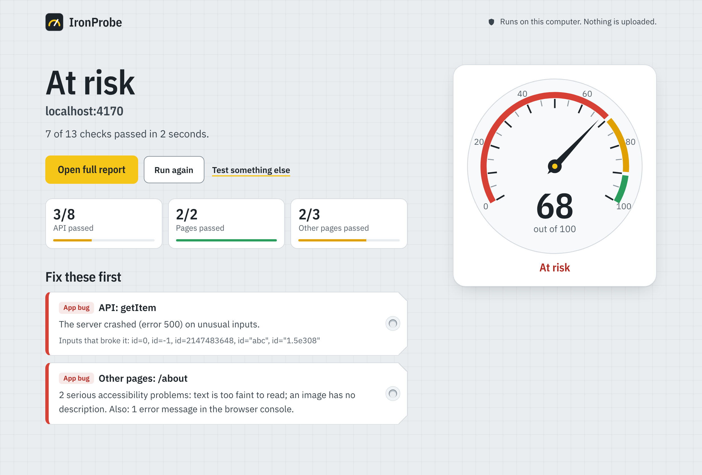
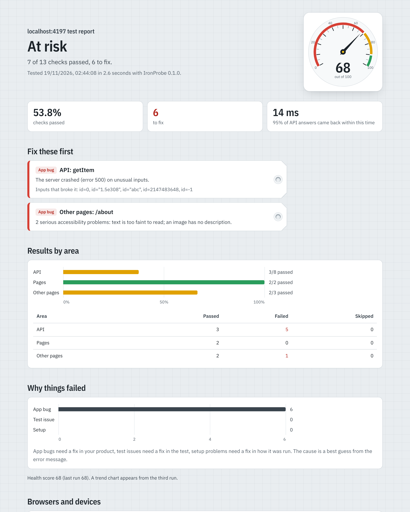

<div align="center">

# IronProbe

### The free, open-source BrowserStack and Postman alternative. One command. On your machine.

Paste a link, get a **health score out of 100** and a plain-English **"fix these first"** list.
Cross-browser and mobile UI testing (Chromium, Firefox, WebKit), API testing (imports Postman, OpenAPI
and HAR), API fuzzing, accessibility (WCAG), Core Web Vitals, visual regression and load tests, with an
AI test agent for Claude Code. No account, no cloud, no telemetry.

[](https://github.com/Pradeep411/ironprobe/actions/workflows/ci.yml)
[](LICENSE)


```bash
npx github:Pradeep411/ironprobe                         # opens the dashboard: paste a link, press Test
npx github:Pradeep411/ironprobe https://your-site.com   # or test straight from the terminal
```



</div>

## Zero setup

Run `npx github:Pradeep411/ironprobe` (you need [Node.js](https://nodejs.org) 20 or newer). A dashboard opens on your own computer. Paste your site's address, optionally
drop in a Postman collection, OpenAPI spec or HAR recording, and press **Test it**. The first time,
IronProbe downloads its test browser by itself (about two minutes, once). After that, in about a minute
you get:

- a **health score out of 100**, and whether it went up or down since last time
- **"Fix these first"**: each problem in plain words, with where it happens (laptop, phone, API)
- the full report with screenshots, traces, speed and accessibility details



No config file, no account, no sign-up. Every run is saved, so your score history builds up
and visual changes are caught from the second run on. When you want full control, `ironprobe init`
gives you config files to commit to your repo.

## The 60-second pitch

Most teams pay for two tools to answer one question: **"does my app still work, for everyone?"**
A device cloud for the browser side (around $129 to $169 per parallel session per month) and an API
platform for the backend ($19 per user per month, with your collections synced to someone else's cloud).

IronProbe does the everyday part of both jobs **locally, for free**, and writes one report a human can
read in a minute:

- **"Fix these first"** at the top: every failure with its cause (your app, the test, or the setup).
- **It finds bugs you never wrote a test for.** Point it at an OpenAPI spec with `--fuzz` and it throws
  edge cases at every endpoint. On the bundled demo app it makes the server crash with unusual IDs
  that no test was written for.
- **It checks outcomes, not clicks.** A test can reload the page and call your API to prove the data was
  really saved, which is where AI-written tests usually cheat.
- **Your secrets stay yours.** No cloud sync, no account, no telemetry. Tokens are masked in every
  output, and `ironprobe scan` catches keys hard-coded in tests and Postman exports.
- **No lock-in.** Tests are YAML files in your repo. `ironprobe export playwright` turns them into plain
  Playwright code any time.

## See it catch bugs (2 minutes)

```bash
git clone https://github.com/Pradeep411/ironprobe && cd ironprobe
npm install && npx playwright install chromium
DEMO_BUGS=1 node examples/demo-app/server.js &
cd examples && DEMO_PASS=secret-pass npx ironprobe run   # demo-only password  ironprobe:ignore
```

The demo app has bugs planted on purpose: a 500 instead of a 404, a slow endpoint, an item that
vanishes after reload, and an inaccessible page. IronProbe finds all of them, and its fuzzer also
crashes the item endpoint with unusual IDs (like `0` and `2147483648`) that no test was written for.
Restart the app without `DEMO_BUGS` and run again: every check passes (39 checks with Chromium;
more if Firefox and WebKit are installed).

## What it replaces, job by job

| You do this today in... | IronProbe |
|---|---|
| Postman collections and runner | YAML suites in git: variables, chaining, JSONPath and JSON-Schema checks, latency budgets, setup and teardown. **Imports your Postman v2.1 collections and OpenAPI 3 specs** |
| Postman mock servers | `ironprobe mock openapi.yaml` |
| An API fuzzer | `--fuzz` on an OpenAPI import: odd inputs must never cause a 5xx |
| BrowserStack / LambdaTest sessions | Chromium, Firefox and WebKit × any device profile (iPhone, Pixel, iPad and more) |
| "Does it work on slow Indian 3G?" | Network presets `3g-india`, `slow-4g`, `4g`, `offline`, plus locale, time zone and location |
| Percy / visual review tools | Pixel diff against stored baselines per browser, device and page, with masks |
| Accessibility scanners | axe-core WCAG 2.2 A/AA on every page and every crawled page |
| Lighthouse runs | LCP, FCP, TTFB and CLS against budgets you set |
| A load-testing tool | Capped load tests with p50/p95/p99, requests per second and error-rate thresholds |
| Chrome extension QA | Loads your unpacked extension and tests its popup and pages |
| Screen recordings of failures | Screenshot and Playwright trace for every failed test |
| A CI dashboard | `report.html`, `junit.xml` and exit codes `0` / `1` / `2` |

**What it is not:** IronProbe runs real browser engines with device emulation, not a farm of physical
phones. WebKit is close to Safari on iOS but not identical. For final checks on physical devices, use
a real phone, the iOS Simulator or Android Emulator, or rent a device cloud by the minute.

## An AI test engineer inside Claude Code

```
/plugin marketplace add Pradeep411/ironprobe
/plugin install ironprobe@ironprobe
/ironprobe:test http://localhost:3000
```

- **test-architect** reads your code, spec or one sentence ("test signup and checkout") and writes the
  coverage plan and test suites.
- **failure-triager** groups failures by cause, explains each in plain words and fixes broken selectors
  without ever weakening a check.
- **coverage-scout** compares what your app has with what is tested and lists the riskiest gaps.

The agents treat everything from the app under test as data, never as instructions.

## Quick start

```bash
npm i -D github:Pradeep411/ironprobe
npx playwright install            # Chromium, Firefox and WebKit
npx ironprobe init                # creates ironprobe.config.yaml and tests/
# set baseUrl and allowedHosts, then:
npx ironprobe doctor              # checks Node, Playwright, browsers, config and your app
npx ironprobe run
```

Already on Postman? `npx ironprobe import postman my-collection.json`. Scripts in the collection are
never executed; common checks are translated and the rest are listed for review.

## Writing tests

```yaml
# tests/api.yaml
name: Orders API
setup:
  - name: Login
    request: { method: POST, url: /api/login, json: { user: demo, pass: "{{env.DEMO_PASS}}" } }
    expect: { status: 200 }
    extract: { token: "$.token" }
tests:
  - name: Create order
    request:
      method: POST
      url: /api/orders
      headers: { Authorization: "Bearer {{token}}" }
      json: { sku: "A1", qty: 2 }
    expect:
      status: 201
      maxMs: 500
      body: { "$.id": { type: number }, "$.qty": 2 }
    extract: { orderId: "$.id" }
teardown:
  - name: Delete order
    request: { method: DELETE, url: "/api/orders/{{orderId}}", headers: { Authorization: "Bearer {{token}}" } }
    expect: { status: [200, 204] }
```

```yaml
# tests/ui.yaml: check outcomes, not just clicks
name: Checkout
tests:
  - name: Item stays in cart after reload
    steps:
      - goto: /shop
      - click: "text=Add to cart"
      - reload: true
      - expectText: { selector: "#cart", text: "1 item" }
      - request: { url: /api/cart, expect: { status: 200, body: { "$.items.length": 1 } } }
```

UI steps: `goto`, `click`, `fill`, `press`, `select`, `check`, `hover`, `waitFor`, `wait`, `reload`,
`request`, `expectVisible`, `expectHidden`, `expectText`, `expectUrl`, `expectTitle`, `screenshot`.
Each test gets a fresh browser session. A test that passes only on retry is marked flaky.

## Commands

| Command | What it does |
|---|---|
| `ironprobe [--port 4300] [--no-open]` | Opens the dashboard (local only, token-protected) |
| `ironprobe <url> [api files...] [--all-browsers] [--network 3g-india] [--allow-writes] [--open]` | Tests a site from just its address. Set `IRONPROBE_TOKEN` (or `--token`) to test APIs that need a login |
| `ironprobe init` | Starter config and tests |
| `ironprobe doctor` | Checks the setup and prints the exact fix for each problem |
| `ironprobe run [--only api,ui,crawl,load] [-c file] [-o dir] [--headed] [--update-baselines] [--fail-on-skip]` | Runs and writes the report |
| `ironprobe import postman <file>` | Converts a Postman collection |
| `ironprobe import openapi <file> [--fuzz] [--include-writes]` | Generates contract tests from a spec |
| `ironprobe import har <file> [-o out.yaml] [--host example.com]` | Turns a browser recording into API checks, with secrets replaced by variables |
| `ironprobe mock <openapi file> [--port 4020]` | Local mock API |
| `ironprobe scan [paths]` | Finds hard-coded secrets in tests and collections |
| `ironprobe export playwright [-o dir]` | Exports UI tests as plain Playwright code |

## Safe by default

IronProbe sends real traffic, so it fails closed. With a config file you list `allowedHosts`; every
API call, redirect hop, browser request, WebSocket and crawl link outside that list is blocked by a
local allow-list proxy. In quick mode (`ironprobe <url>` and the dashboard) IronProbe only visits,
crawls and calls APIs on the address you typed; like a normal visit, the page may load its own files
from public hosts, but never from your private network, and common analytics trackers are skipped.
Requests that change data in Postman files are not replayed unless you allow it. Load tests need
`iOwnThisTarget: true` and are capped. Full model in [SECURITY.md](SECURITY.md).

## Roadmap

- Electron and desktop apps; iOS Simulator and Android Emulator runners
- Tests recorded from real traffic; multi-step API fuzzing
- MCP server so any coding agent can read results; pull-request comments
- Run only the tests affected by a change
- Scheduled monitoring with alerts

**Star the repo** if IronProbe saved you a subscription, and
[open an issue](https://github.com/Pradeep411/ironprobe/issues/new/choose) with the bug it caught or the
feature you miss. Design: [ARCHITECTURE.md](ARCHITECTURE.md). Research behind the feature set:
[docs/RESEARCH.md](docs/RESEARCH.md).

## License

MIT. The bundled IBM Plex fonts are under the SIL Open Font License 1.1
([src/dashboard/fonts/OFL.txt](src/dashboard/fonts/OFL.txt)).
